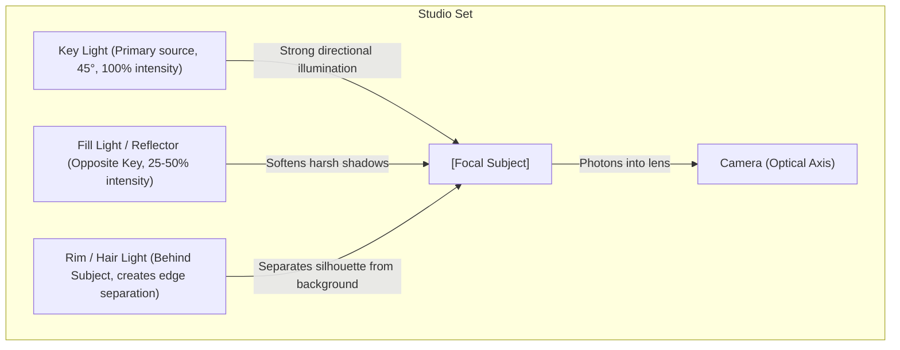
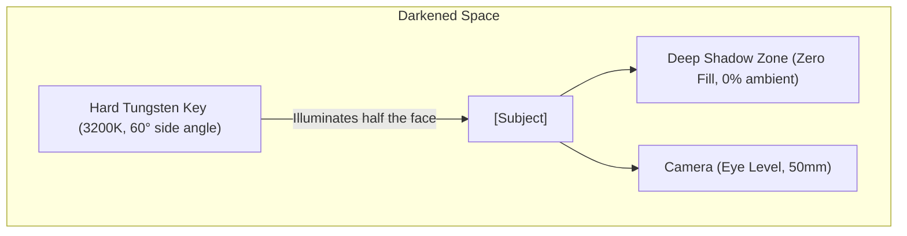
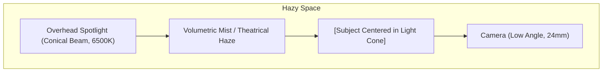

# Cinematic Lighting & Optical Schematics
### *Physical Illumination Diagrams & Optical Physics*
**Architect:** **Muhammad Nasir Khan**

Lighting and optical framing dictate spatial depth, character presence, and color grading. Use these exact physical setups and diagrams in your prompts.

---

## 1. The Classical 3-Point Lighting Diagram



### Prompt Translation for 3-Point Lighting:
```text
Look: Three-point cinematic studio lighting: 5600K key light from 45 degrees camera-left, soft diffused bounce fill on camera-right, and high-intensity warm rim light carving a sharp golden outline along the hair and shoulders.
```

---

## 2. Low-Key Film Noir (Chiaroscuro)



### Prompt Translation for Chiaroscuro:
```text
Look: High-contrast chiaroscuro lighting: single hard 3200K tungsten lamp illuminating only the left profile of the face, leaving the opposite side in complete, impenetrable shadow. Zero fill light.
```

---

## 3. Top-Down Volumetric Spotlight (Stage / Cyberpunk)



### Prompt Translation for Volumetric Top-Light:
```text
Look: Single vertical overhead spotlight casting a defined conical beam through dense theatrical haze; sharp floor pool of light with deep falloff beyond the light circle.
```

---

## 4. Optical Lens Characteristics Matrix

| Focal Length | Typical Field of View | Perspective Distortion | Bokeh / Depth of Field | Best Application |
| :---: | :---: | :--- | :--- | :--- |
| **24mm** | ~84° (Wide) | Slight edge expansion; enhances speed and scale | Deep depth of field; environmental sharpness | Establishing shots, architectural spaces, Action Runs |
| **35mm** | ~63° (Moderate Wide) | Natural street perspective; minimal distortion | Moderate depth of field; classic documentary feel | Street-level narrative, full-body dialogue |
| **50mm** | ~47° (Standard) | Zero distortion; mirrors natural human eye sight | Smooth background blur at F2.0 | Conversational mid-shots, naturalistic realism |
| **85mm** | ~29° (Portrait) | Flattering facial compression; tightens features | Creamy, melted background bokeh at F1.4 | High-emotion close-ups, character epiphanies |
| **100mm Macro** | ~24° (Macro) | Extreme compression; isolates micro-textures | Razor-thin focus plane (millimeters) | Jewelry, water droplets, mechanical movements |
| **200mm+** | <12° (Telephoto) | Flattened perspective; brings background near | Compressed atmospheric heat/dust waves | Wildlife stalks, sniper perspectives, sports tracking |
